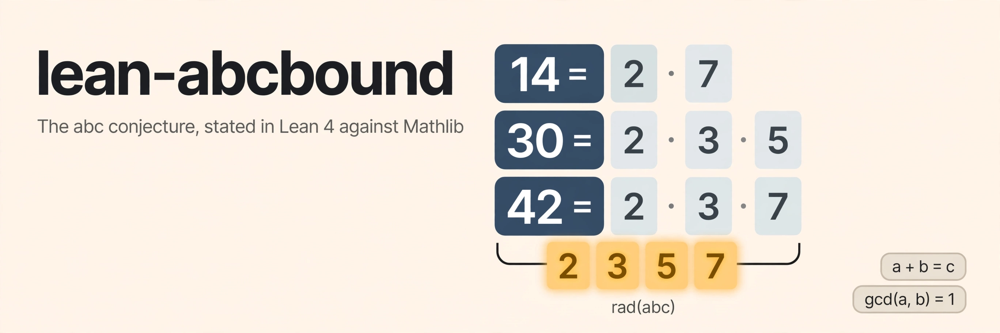

<p align="center">
  
</p>

<p align="center"><strong>The abc conjecture, stated in Lean 4 against Mathlib, with checks on what the statement says</strong></p>

<p align="center">
  <a href="https://github.com/conao3/lean-abcbound/actions/workflows/ci.yml"></a>
  <a href="LICENSE"></a>
  <a href="lean-toolchain"></a>
  <a href="https://github.com/conao3/lean-abcbound/stargazers"></a>
</p>

<p align="center">
  <a href="#status">Status</a> |
  <a href="#the-statement">Statement</a> |
  <a href="#checked-results">Checked results</a> |
  <a href="docs/roadmap.md">Roadmap</a> |
  <a href="#commands">Commands</a>
</p>

# lean-abcbound

lean-abcbound states the abc conjecture of Masser and Oesterlé in Lean 4 against Mathlib. It also collects theorems that check the statement says what we intend.

## Status

`Abc.ABCConjecture` is a `Prop`, and the conjecture is still open. The goal of this repository is a proof of it. We'll count the goal as reached when the library contains a theorem `Abc.abc : Abc.ABCConjecture` and its `#print axioms` output lists `propext`, `Classical.choice`, and `Quot.sound` only.

## The statement

`Abc/Statement.lean` imports Mathlib alone.

```lean
def rad (n : ℕ) : ℕ := ∏ p ∈ n.primeFactors, p

def ABCConjecture : Prop :=
  ∀ ε : ℝ, 0 < ε → ∃ K : ℝ, ∀ a b c : ℕ, 0 < a → 0 < b → a.Coprime b → a + b = c →
    (c : ℝ) < K * (rad (a * b * c) : ℝ) ^ (1 + ε)
```

This is the constant form of the conjecture. It has the same shape as `abc.variants.lt_constant_mul` in [google-deepmind/formal-conjectures](https://github.com/google-deepmind/formal-conjectures/blob/main/FormalConjectures/Wikipedia/ABC.lean).

## Checked results

- `Abc/Sanity.lean`: `rad` equals Mathlib's `UniqueFactorizationMonoid.radical` on `ℕ`, values of `rad` on concrete inputs, and `not_bound_without_coprime`. That theorem shows the bound fails once you drop the coprimality hypothesis, with `2 ^ n + 2 ^ n = 2 ^ (n + 1)` as the witness.
- `Abc/Radical.lean`: `rad_pos`, `rad_dvd`, `rad_le`, `rad_mul` for coprime factors, and `rad_mul_mul_add`.
- `Abc/Equivalent.lean`: `abcConjecture_iff_pairwise` and `abcConjecture_iff_finite`. The first covers the statement with `c` positive and `{a, b, c}` pairwise coprime. The second covers the form where, for every `ε > 0`, finitely many coprime triples satisfy `rad (a * b * c) ^ (1 + ε) < c`.

`audit.expected` records the axioms each of these theorems depends on.

## Where to continue

[docs/roadmap.md](docs/roadmap.md) lists the next steps inside this repository. It also gives the starting point of each stage of the route through inter-universal Teichmüller theory.

## Commands

```console
$ nix develop --command make check
```

`make check` formats the flake, downloads the prebuilt Mathlib, builds the library, and compares the axiom audit with `audit.expected`. `make audit` regenerates `audit.expected`.

## License

Apache-2.0
